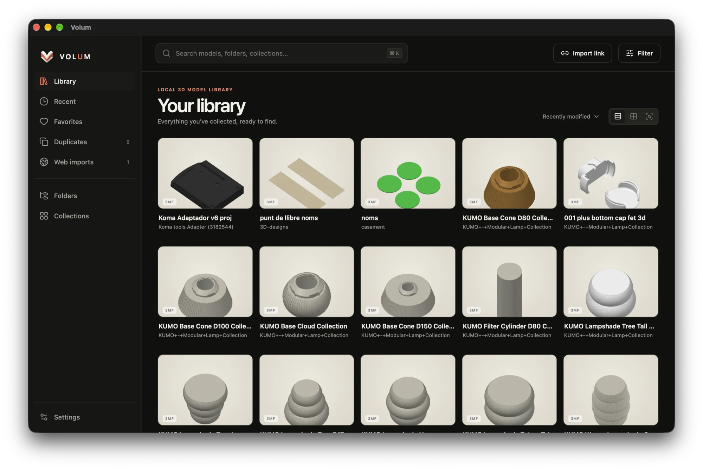
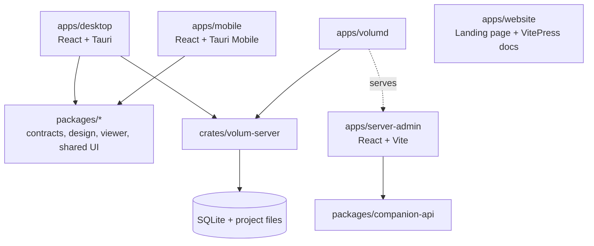

<div align="center">
  
  <h1>Volum</h1>
  <p><strong>A beautiful, private home for your 3D-printing projects.</strong></p>
  <p>
    <a href="https://github.com/sabatesduran/volum/actions/workflows/ci.yml"></a>
    <a href="https://github.com/sabatesduran/volum/releases/latest"></a>
    <a href="LICENSE"></a>
    <a href="https://ko-fi.com/didacdev"></a>
  </p>
  <p>
    <a href="https://volum.didac.dev/">Website</a> ·
    <a href="https://volum.didac.dev/docs/">Documentation</a> ·
    <a href="https://github.com/sabatesduran/volum/releases/latest">Download</a> ·
    <a href="CONTRIBUTING.md">Contribute</a>
  </p>
</div>



Volum is a local-first library for STL, 3MF, OBJ, STEP, and STP projects. It indexes folders you already have, groups related source and printable files, creates visual previews, and adds search and organization without requiring an account or hosted Volum cloud.

Start with the Desktop app on one computer. When you need more, the same library can be shared with trusted devices from Desktop or moved to an always-on `volumd` server.

> [!NOTE]
> Volum Companion and the dedicated server are in early access. Desktop remains the normal starting point; test server workflows with a non-critical library and keep independent backups.

## Why Volum

- **Keep your files where they are.** Index local folders, removable drives, and mounted shares without automatically renaming or moving their contents.
- **See projects, not file dumps.** Related files become project bundles with native previews, thumbnails, 3MF plate information, and an interactive 3D viewer.
- **Find anything quickly.** Search, filters, folders, favorites, collections, saved searches, recents, and duplicate detection scale to large libraries.
- **Document the whole build.** Store photos, materials, custom fields, bills of materials, assembly steps, notes, and cost estimates beside each project.
- **Stay local and private.** The apps work without an account, required network connection, hosted relay, or application analytics.
- **Add devices on your terms.** Pair another Desktop or the mobile companion over Tailscale, a trusted private network, or HTTPS.

## Choose how to run Volum

| Setup | Canonical library | Best for |
| --- | --- | --- |
| **Local Desktop** | The computer running Volum | One computer, removable drives, or mounted folders |
| **Desktop host** | A Desktop with Companion Access enabled | Reaching an existing library from a phone or another Desktop |
| **Dedicated `volumd`** | A NAS or home server | An always-on managed library shared by trusted devices |

The **canonical library** owns the database, organization, and authoritative project files. Remote clients send authenticated commands to it.

> [!IMPORTANT]
> Choose one canonical Desktop or `volumd` server. Never synchronize, merge, or independently edit `volum.sqlite3` between machines. A Desktop mirror contains verified original files and a private manifest—not another Volum database.

[Compare the three setups](https://volum.didac.dev/docs/getting-started/choose-a-setup) or read the [architecture reference](https://volum.didac.dev/docs/reference/architecture).

## Get Volum

Download the [latest Desktop release](https://github.com/sabatesduran/volum/releases/latest):

- **macOS:** universal, signed, and notarized DMG for Apple silicon and Intel Macs
- **Windows:** native x64 and ARM64 installers
- **Linux:** x86_64 AppImage, with Arch Linux packaging prepared alongside releases

Volum does not require an account or activation key. Follow the [Desktop installation guide](https://volum.didac.dev/docs/getting-started/install-desktop), then [create your first library](https://volum.didac.dev/docs/getting-started/first-library).

Volum Companion for iPhone, iPad, and Android is currently distributed as an invited beta or built from source. Each GitHub release includes a signed Android APK for sideloading; iOS remains a source/TestFlight build. See the [mobile overview](https://volum.didac.dev/docs/companion/overview) for availability and requirements.

To enable signed Android release APKs, configure the GitHub Actions secrets `ANDROID_KEYSTORE_BASE64` (base64-encoded keystore), `ANDROID_KEYSTORE_PASSWORD`, `ANDROID_KEY_ALIAS`, and `ANDROID_KEY_PASSWORD`. Generate a release keystore with:

```sh
keytool -genkeypair -v -keystore volum-release.jks -alias volum -keyalg RSA -keysize 4096 -validity 10000
```

## Self-host with `volumd`

`volumd` runs the same migrations, indexing, managed storage, and authenticated API as Desktop without compiling a GUI or credential-store runtime. The supplied Docker image also serves a small browser administrator.

For a development or early-access deployment:

```bash
export VOLUM_PUBLIC_URL=http://volum-nas.your-tailnet.ts.net:43821
read -rsp "Volum administrator password: " VOLUM_ADMIN_PASSWORD
export VOLUM_ADMIN_PASSWORD
docker compose up -d --build
```

Use a private Tailscale/LAN/VPN address or trusted HTTPS origin, and persist both `/config` and `/library`. Read the [self-hosting guide](https://volum.didac.dev/docs/server/) before importing a real library; it covers Docker, networking, storage, backups, updates, and recovery.

## Monorepo architecture



Desktop calls `volum-server` directly in local mode. In remote mode, Desktop, mobile, and the browser administrator use the authenticated `/api/v1` contract. The Desktop networking adapter and mobile secure transport are native Rust, so bearer tokens do not enter the React webviews.

### Applications

| Path | Role | Main stack |
| --- | --- | --- |
| `apps/desktop/` | Primary local and remote Desktop client | React, Vite, Tauri 2, Rust |
| `apps/mobile/` | iOS and Android companion | React, Vite, Tauri Mobile, Rust |
| `apps/server-admin/` | Browser administrator bundled with `volumd` | React, Vite |
| `apps/volumd/` | Standalone headless server entry point | Rust, Tokio |
| `apps/website/` | Product website and public documentation | Vite, VitePress |

### Shared code

| Path | Responsibility |
| --- | --- |
| `crates/volum-server/` | Transport-neutral indexing, storage, migrations, geometry, and Axum services |
| `packages/companion-api/` | OpenAPI contract, generated types, normalized errors, and injected client transport |
| `packages/design/` | Semantic design tokens, dark mode, reduced motion, and portable CSS primitives |
| `packages/photo-room/` | Shared Desktop and mobile photo/video editor |
| `packages/shared/` | QR payloads, formatting, localization, and cache policies |
| `packages/viewer/` | Viewer parsing, materials, bounds, and model normalization |

The Rust projects form one workspace owned by the root `Cargo.toml` and `Cargo.lock`. JavaScript applications and packages intentionally keep separate `package-lock.json` files; the root `Makefile` and `package.json` dispatch commands into each project rather than treating them as one npm workspace.

Brand artwork lives in `assets/brand/`, public documentation in `apps/website/docs/`, internal implementation plans in `docs/plans/`, App Store metadata in `metadata/`, and distribution files in `packaging/`.

## Development

### Requirements

- Node.js 22.23.4, pinned in `.nvmrc`
- Rust 1.99.1 with Clippy and rustfmt, pinned in `rust-toolchain.toml`
- [Tauri 2 platform prerequisites](https://v2.tauri.app/start/prerequisites/)
- Platform SDKs for native mobile development
- Docker with Compose v2 for server-image work
- Make, recommended for repository-level commands

### Start Desktop

```bash
make doctor
make setup
make desktop-dev
```

`make setup` installs every JavaScript project's locked dependencies. Cargo downloads Rust dependencies on the first Rust build.

For a browser-only Desktop preview with representative mock data:

```bash
make desktop-web-dev
```

### Common commands

| Command | Purpose |
| --- | --- |
| `make desktop-dev` | Run the native Desktop app |
| `make mobile-dev` | Run the mobile browser preview |
| `make mobile-ios-dev` | Run the iOS app |
| `make mobile-android-dev` | Run the Android app |
| `make server-admin-dev` | Run the browser administrator |
| `make volumd-run` | Run the headless server |
| `make website-dev` | Run the product website and documentation |
| `make website-docs-dev` | Run only VitePress documentation |
| `make check` | Build and test all source packages |
| `make compose-check` | Validate the supplied Compose configuration |

Use `APP` to target generic commands—for example, `make dev APP=mobile`, `make build APP=website`, or `make test APP=viewer`. Run `make help` for every supported target and argument.

Rust and native mobile builds can consume substantial disk space. `make disk-usage` reports generated data, `make clean` removes regenerable build output, and `make clean-all` also removes `node_modules`. Cleanup targets preserve environments, signing material, Goldie output, and saved Xcode archives.

API contract changes must update `packages/companion-api/openapi.json`, regenerate `generated.ts`, and pass `generate:check`; generated types should not be edited by hand.

## Documentation

- [Getting started](https://volum.didac.dev/docs/getting-started/introduction)
- [Desktop and remote access](https://volum.didac.dev/docs/desktop/companion-access)
- [Volum Companion](https://volum.didac.dev/docs/companion/overview)
- [Self-hosting](https://volum.didac.dev/docs/server/)
- [Architecture](https://volum.didac.dev/docs/reference/architecture)
- [Security model](https://volum.didac.dev/docs/reference/security)
- [Troubleshooting](https://volum.didac.dev/docs/help/troubleshooting)
- [Development overview](https://volum.didac.dev/docs/development/)

## Contributing and security

Read [`CONTRIBUTING.md`](CONTRIBUTING.md) before opening a change. Install the repository's Gitleaks pre-commit hook, keep changes focused, and include platform details and reproduction steps for filesystem bugs.

The Volum applications do not require an account and do not send library or model data to Volum. The public product website uses analytics separately and never receives library data; its setup is documented in [`apps/website/README.md`](apps/website/README.md).

Report security issues privately as described in [`SECURITY.md`](SECURITY.md). Never commit credentials, signing keys, pairing payloads, local `.env` files, or sensitive fixtures.

## Support

Volum is free and open source. If it saves you time, [support continued development on Ko-fi](https://ko-fi.com/didacdev).

## License

GPL-3.0-or-later. See [`LICENSE`](LICENSE).

## Languages

Volum Companion uses the operating system's per-app language setting as its source of truth. On iOS 13 and newer, choose a language under **Settings → Apps → Volum → Language**. On Android 13 and newer, use **Settings → Apps → Volum → Language**; older Android versions follow the device language. The language row inside Volum opens the relevant system settings instead of maintaining a second, conflicting preference.

All supported mobile locales are registered once in [`apps/mobile/locales.json`](apps/mobile/locales.json). The locale tooling derives the TypeScript registry, iOS `CFBundleLocalizations` and localized permission descriptions, Android `locales_config.xml`, Goldie locales, and validation rules from that file.

To add a language, run:

```bash
npm --prefix apps/mobile run locale:add -- fr-FR
```

Replace `fr-FR` with a valid BCP-47 locale. The command registers the locale and creates translation templates for the mobile interface, native iOS permission prompts, App Store metadata, and localized Goldie screenshot copy. Translate every generated empty value, then validate everything with:

```bash
npm --prefix apps/mobile run locales:check
```

Useful maintenance commands:

| Command | Purpose |
| --- | --- |
| `npm --prefix apps/mobile run locales:sync` | Regenerate native and TypeScript locale declarations from `locales.json` |
| `npm --prefix apps/mobile run locales:check` | Check message coverage, interpolation placeholders, store assets, and generated files |
| `npm --prefix apps/mobile run locales:xcode` | Regenerate the checked-in Xcode project after changing localized native resources |

Do not edit `apps/mobile/src/locales/generated.ts`, Android `locales_config.xml`, generated iOS `.lproj` files, or the generated `CFBundleLocalizations` blocks by hand. For languages with grammatical plural categories beyond singular/other or for right-to-left layouts, include dedicated linguistic and visual QA before release.
