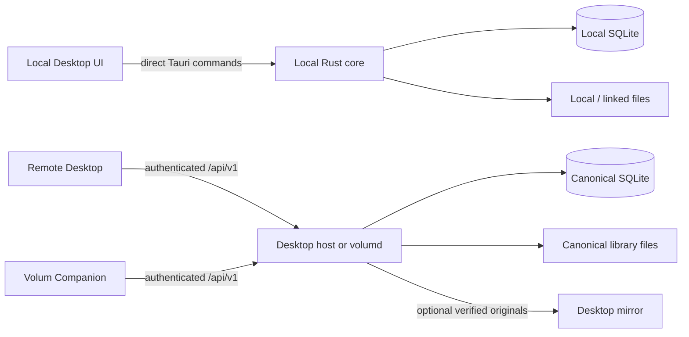

# Volum

**A beautiful home for your 3D-printing projects.**

Volum is a private, local-first library for STL, 3MF, OBJ, STEP, and STP projects. It indexes folders you already have, groups related source and printable files, creates visual previews, and adds searchable organization without requiring an account or a hosted Volum cloud.

Volum works as a standalone Desktop application, as a Desktop-hosted server for trusted devices, or as a dedicated `volumd` server on a NAS. **Standalone Desktop remains the default.**


## Choose how to run Volum

| Mode | Canonical library | Desktop UI | Typical use |
| --- | --- | --- | --- |
| **Local Desktop** | This Desktop | Direct Rust calls; no HTTP hop | One computer, removable drives, or mounted shares |
| **Desktop host** | The hosting Desktop | Host UI remains direct; other clients use `/api/v1` | Share an existing Desktop library over Tailscale, another private network, or HTTPS |
| **Dedicated `volumd`** | The server/NAS | Remote Desktop or Companion client | Always-on managed library in Docker |

“Canonical” means that machine owns the database, metadata, organization, and authoritative files. Remote clients send authenticated commands to it.

> [!IMPORTANT]
> Never synchronize, merge, or independently edit `volum.sqlite3` between machines. Choose one canonical Desktop or `volumd` server. A Desktop mirror contains verified original files and a private manifest—it is not another Volum database.

Returning a remote Desktop to **Local** mode is safe: its original local library is still there and has not been replaced by the server database.

## Architecture



The Desktop host and `volumd` use the same Rust core, migrations, indexer, managed-library implementation, authentication, and Axum API. The webview never receives a bearer token; Desktop networking happens in native Rust.

### Where data lives

| Data | Local mode | Remote mode |
| --- | --- | --- |
| Projects, tags, collections, notes, documentation | Local SQLite | Canonical server SQLite |
| Original project files | Local/linked roots or managed library | Canonical server library |
| UI theme, language, density, local slicer paths | Local Desktop preferences | Still local to each Desktop |
| Remote bearer token | Not applicable | Operating-system credential store |
| Mirrored originals | Not applicable | User-selected mirror folder |
| SQLite database inside a mirror | Never | Never |

## What works

- Multiple local, removable, or mounted library roots
- Progressive recursive indexing with pause/resume, recovery, and filesystem watching
- Stable move detection with fingerprints and a metadata grace period for unavailable files
- Project bundles with persistent manual merge/split decisions, file roles, and a selectable primary preview
- Native STL, OBJ, 3MF, and OpenCascade-backed STEP/STP metadata, tessellation, previews, and thumbnails
- Interactive 3D detail view and persistent background-rendered thumbnails
- FTS5 search, saved searches, folders, recents, favorites, quick filters, and virtualized grids
- Manual collections plus all/any smart rules for text, location, tags, formats, dates, geometry, dimensions, and project state
- Exact-file and geometry-aware duplicate detection with metadata-preserving, Trash-safe guided cleanup
- Materials, project photos, custom fields, BOMs, assembly steps, and cost estimates
- Configurable slicers, OS-default open, and Finder/Explorer/file-manager reveal
- Portable project packages and scheduled local, mounted-share, or WebDAV backups
- English, Catalan, and European Spanish interfaces
- Light, dark, and system themes
- Authenticated Desktop/mobile access through Tailscale, private LAN/VPN routes, or HTTPS
- Optional resumable, BLAKE3-verified Desktop mirror with offline opening and conflict preservation
- No account, analytics, hosted Volum relay, or required network connection

The original product specification is in [`Volum-product-engineering-plan.md`](Volum-product-engineering-plan.md).

## Quick start: local Desktop

Install Volum from [GitHub Releases](https://github.com/sabatesduran/volum/releases/latest), open it, and choose one of these library types:

- **Linked folders:** Volum indexes files in their existing location without moving them.
- **Managed library:** Volum owns a `Projects`, `Inbox`, and `Trash` layout and can safely rename, move, upload, and delete project files.

The Desktop UI calls the local Rust core directly. Companion Access and a mirror are both optional and disabled by default.

## Quick start: Desktop host

Use this when an existing Desktop should remain canonical.

1. For the easiest setup, install and sign in to [Tailscale](https://tailscale.com/) on the host and client devices. Volum detects it automatically.
2. In the host, open **Settings → Companion Access**.
3. Keep **Automatic** for Tailscale, or choose **Custom** and enter the private listener IP plus the separate URL clients will use.
4. Enable Companion Access and decide whether paired devices may perform organization writes.
5. Create a pairing payload. You can edit its advertised URL before showing the QR code. It expires after five minutes and can be used once.
6. On another Desktop, open **Settings → Connection**, paste the payload, and connect. Volum on mobile can scan the same payload, review or edit the address, and then connect.
7. Revoke lost or retired devices from the host.

The host Desktop continues using direct local calls. Only remote clients use the HTTP API.

## Quick start: NAS or dedicated `volumd`

The repository includes a hardened Compose service, a multi-stage Dockerfile, and a GHCR multi-architecture publication workflow targeting `linux/amd64` and `linux/arm64`.

### 1. Choose the address clients will use

`VOLUM_PUBLIC_URL` must be a complete reachable origin with no path, query, credentials, or fragment. Tailscale remains the easiest option:

```bash
export VOLUM_PUBLIC_URL=http://volum-nas.your-tailnet.ts.net:43821
```

Private LAN, WireGuard, Twingate, and ZeroTier addresses may use `http://` when the host resolves to private IPs and the network supplies the trusted boundary. Any public or otherwise non-private route must terminate TLS in a trusted reverse proxy and use an `https://` origin. Never expose plain HTTP port `43821` to the public internet.

### 2. Start the server

```bash
read -rsp "Volum administrator password: " VOLUM_ADMIN_PASSWORD
export VOLUM_ADMIN_PASSWORD
docker compose up -d --build
```

On first startup, `volumd`:

- creates `/config/volum.sqlite3` and authentication configuration;
- creates `/library/Projects`, `/library/Inbox`, and `/library/Trash`;
- runs all database migrations;
- starts indexing and filesystem watchers;
- serves the Volum administrator at `VOLUM_PUBLIC_URL`.

Open `VOLUM_PUBLIC_URL`, sign in with the administrator password, select **Pair device**, and scan the five-minute, single-use QR code with Volum on your phone. You can remove the clear-text environment value after the first successful start because only its Argon2id hash is persisted under `/config`.

Container-log pairing remains available as an emergency fallback:

```bash
export VOLUM_PRINT_PAIRING=true
docker compose up -d
docker compose logs -f volumd
```

For a persistent deployment, put both values in a private `.env` file beside `compose.yaml`:

```dotenv
VOLUM_PUBLIC_URL=http://volum-nas.your-tailnet.ts.net:43821
VOLUM_ADMIN_PASSWORD=
VOLUM_PRINT_PAIRING=false
VOLUM_ORGANIZATION_WRITES=true
```

Fill the blank password value with a private value of at least 12 characters before starting Compose.

### 3. Persist the database and library

The supplied Compose file creates two named volumes:

- `volum-config` → `/config`: SQLite, migrations, and server authentication settings;
- `volum-library` → `/library`: authoritative managed project files.

NAS bind mounts are often easier to inspect and snapshot:

```yaml
services:
  volumd:
    volumes:
      - /volume1/docker/volum/config:/config
      - /volume1/3d/Volum:/library
```

Both directories must be writable by UID/GID `1000:1000`, unless the container is explicitly run as another owning user.

### 4. Check health

```bash
curl --fail http://127.0.0.1:43821/healthz
# ok
```

See the [self-hosting documentation](website/docs/server/index.md) for installation, environment variables, firewall guidance, storage, and recovery details.

## Pairing, authentication, and transport security

- Pairing payloads expire after five minutes and are single-use.
- Successful pairing returns a random bearer token.
- The server stores only a hash of that token.
- Desktop stores its token in the operating-system credential store, never in `remote.json` or the webview.
- Revocation is checked server-side immediately.
- `/identity`, `/pair`, `/healthz`, and the bounded web login/bootstrap routes are the only unauthenticated endpoints.
- The web administrator uses an explicit per-browser bearer token stored in IndexedDB, not cookies or ambient browser authentication.
- Desktop and mobile accept any trusted `https://` origin.
- Plain HTTP is accepted only for loopback, private IPv4/IPv6, link-local, Tailscale, or hostnames that resolve entirely to private addresses. Public HTTP is rejected.
- Clients call `/identity` and verify the expected server ID and protocol before sending a one-time pairing secret or using a token at a replacement address.
- QR payload transports are `tailscale-http`, `private-http`, or `https`; existing `tailscale-http` payloads remain compatible.
- `VOLUM_ORGANIZATION_WRITES=false` makes paired clients read-only for organization and managed-file mutations.

Tailscale encrypts traffic between Tailnet devices even when the application origin is `http://`. Other private HTTP routes rely on the LAN or VPN for confidentiality, so use only networks you trust. Firewall port `43821` so it is reachable only from intended private clients or a trusted reverse proxy.

## What remote Desktop can do

Remote Desktop uses the same screens and `/api/v1` contract for:

- browse, search, filters, folders, favorites, recent projects, and Trash;
- project creation and managed-file uploads;
- project rename, favorite, notes, tags, manual/smart collections, and saved searches;
- project photos, custom fields, BOMs, assembly instructions, materials, and estimates;
- original-file, thumbnail, plate-thumbnail, and viewer-mesh reads;
- project trash, restore, and permanent deletion;
- duplicate detection in read-only review mode.

Some operations intentionally remain on the canonical machine because they are filesystem administration or destructive library maintenance:

- adding/reconnecting linked roots and controlling scans;
- converting linked projects into managed storage;
- project merge/split, primary-file changes, and duplicate cleanup;
- project-package import/export;
- web-import ingestion;
- server backup/restore and Companion host administration.

These controls are hidden in remote mode, and the Desktop API adapter blocks every unimplemented remote command by default. It never falls back to mutating the local library.

## Optional local project files

A remote Desktop may keep verified originals for offline opening and slicer access. Each Desktop can choose **Selected projects** or **Entire library** independently:

1. Open **Settings → Connection**.
2. Choose whether to keep selected projects or the entire library locally.
3. Choose an empty, private local folder and run **Sync now**. Desktop also synchronizes periodically while remote mode is active.

In selected mode, individual projects can be kept from their card or detail view. Folder and collection controls create live rules: projects added later—including projects entering a smart collection—are downloaded automatically. An individual project can be excluded from a broader rule.

The mirror stores normal project files plus `.volum/manifest.json` and resumable partial downloads. It never stores or synchronizes SQLite.

### Synchronization rules

| Server copy | Local mirrored copy | Result |
| --- | --- | --- |
| Unchanged | Unchanged | No transfer |
| Changed | Unchanged | Download and verify server copy |
| Unchanged | Changed | Upload with `If-Match` |
| Changed | Changed | Move local copy to `Conflicts/`, then download server copy |
| Deleted | Unchanged | Delete mirrored copy |
| Deleted | Changed | Preserve local copy under `Conflicts/` |

Downloads support HTTP ranges and resume from `.part` files. A completed file is activated only after its size and BLAKE3 `ETag` match. Local replacements are accepted only when the server still has the exact revision originally downloaded.

When the server is offline, Desktop shows the verified files already present in the mirror and can open or reveal them. Metadata browsing and edits remain unavailable until the canonical server reconnects.

> [!CAUTION]
> `Conflicts/` is preservation, not automatic merging. Review those files manually and upload or import the version you want to keep.

## Backup and recovery

### Local Desktop or Desktop host

Use **Settings → Backups** for scheduled ZIP backups to a local folder, mounted NAS share, or WebDAV destination. The host owns the canonical database, so backup and restore must be run there.

### Dedicated `volumd`

Remote backup administration is intentionally not exposed yet. Back up `/config` and `/library` together using NAS/container snapshots while `volumd` is stopped:

```bash
docker compose stop volumd
# Snapshot or copy both persistent mounts here.
docker compose start volumd
```

Restore both locations from the same recovery point. Do not copy only `volum.sqlite3`, do not omit the managed library, and do not synchronize SQLite, `-wal`, or `-shm` files independently.

## Server environment

| Variable | Default | Purpose |
| --- | --- | --- |
| `VOLUM_CONFIG_DIR` | `/config` | Database and authentication configuration |
| `VOLUM_LIBRARY_DIR` | `/library` | Canonical managed project files |
| `VOLUM_BIND` | `0.0.0.0:43821` | Listener IP and port |
| `VOLUM_PUBLIC_URL` | Loopback-derived | Reachable origin embedded in pairing payloads; required by Compose |
| `VOLUM_ORGANIZATION_WRITES` | `true` | Allow paired clients to edit organization and managed files |
| `VOLUM_PRINT_PAIRING` | `false` | Print a fresh five-minute pairing payload at startup only when explicitly enabled |

## Troubleshooting

### The client cannot reach the server

- Open `VOLUM_PUBLIC_URL/healthz` from the client device.
- Confirm `VOLUM_PUBLIC_URL` is the address the client can reach, not `0.0.0.0` or a container-only hostname.
- Check the NAS firewall and any Tailscale ACL, WireGuard, Twingate, ZeroTier, VLAN, or reverse-proxy policy.
- Confirm HTTP names resolve only to private addresses. Use HTTPS for public names or routes.

### Pairing is rejected

- Generate a new payload; the previous one may have expired or already been used.
- Confirm `/identity` belongs to the expected server.
- Check that the system clocks are reasonably synchronized.

### Desktop is offline but files should be available

- Only completed, verified mirror files are available offline.
- Open **Settings → Connection** after reconnecting and run **Sync now**.
- Files under `Conflicts/` are intentionally excluded from automatic replacement.

### Open or Reveal is unavailable remotely

Original files need a configured mirror before Desktop can hand a safe local path to a slicer or file manager. Viewer meshes and thumbnails can still stream from an online server without a mirror.

## Current production-readiness notes

The local/Desktop-host/headless architecture and real-server mirror conflict flow are covered by automated tests. Before treating the NAS image as generally available, the project still needs:

- real `linux/amd64` and `linux/arm64` Docker builds and health tests on NAS hardware;
- end-to-end private-network/HTTPS and native credential-store testing on every supported Desktop platform;
- hardening for duplicate filenames mapping to one mirror path;
- a retention/compaction policy for the durable `sync_changes` log;
- migration and recovery testing against a copy of a large production database.

## Downloads

- **macOS:** universal, signed, and notarized DMG from [GitHub Releases](https://github.com/sabatesduran/volum/releases/latest)
- **Linux x86_64:** AppImage and Arch Linux package from [GitHub Releases](https://github.com/sabatesduran/volum/releases/latest)
- **Windows x64:** native [NSIS installer](https://github.com/sabatesduran/volum/releases/latest/download/Volum_windows_x86_64_setup.exe)
- **Windows ARM64:** native [NSIS installer](https://github.com/sabatesduran/volum/releases/latest/download/Volum_windows_arm64_setup.exe)

The Linux AppImage is built on Ubuntu 22.04 for broad glibc compatibility. Automated publication of the `volum-bin` package to the AUR is prepared and will be enabled after its maintainer account is configured.

Windows installers are not yet Authenticode-signed, so Microsoft Defender SmartScreen may ask for confirmation. Tauri updater signatures and SHA-256 checksum files are published beside both installers.

## Development

Requirements:

- Node.js 20+
- Rust stable
- [Tauri 2 platform prerequisites](https://v2.tauri.app/start/prerequisites/)

```bash
npm install
npm run tauri dev
```

Browser-only UI preview, using a representative mock library:

```bash
npm run dev
```

Validation:

```bash
npm run build
npm test -- --run
npm --prefix mobile run build
npm --prefix mobile test -- --run
cargo fmt --manifest-path src-tauri/Cargo.toml -- --check
cargo clippy --manifest-path src-tauri/Cargo.toml --all-targets -- -D warnings
cargo test --manifest-path src-tauri/Cargo.toml
VOLUM_PUBLIC_URL=http://100.64.0.1:43821 docker compose config -q
```

The master icon is [`volum-appicon.png`](volum-appicon.png). Regenerate platform assets with:

```bash
npx tauri icon volum-appicon.png
```

## Release signing

- The updater public key is committed in `src-tauri/tauri.conf.json`; its private key is stored only as a GitHub Actions secret.
- macOS releases are universal Developer ID builds, notarized by Apple, and stapled before publication.
- iOS development reads `APPLE_DEVELOPMENT_TEAM` from the ignored `mobile/.env` file. Copy `mobile/.env.example` locally and add the Apple Team ID; never commit the local file.
- Linux AppImages and both Windows installers include Tauri updater signatures and SHA-256 checksums.
- Windows installers are not yet Authenticode-signed.
- The updater endpoint uses the canonical [`sabatesduran/volum`](https://github.com/sabatesduran/volum) repository.

Private signing keys and pairing payloads must never be committed.

## Privacy and security

The React webview has no general filesystem or shell permission. File paths received over IPC are resolved from database asset IDs and revalidated against approved roots in Rust. Archive traversal and decompression limits are enforced for ZIP-based formats. Remote DTOs do not expose canonical absolute paths, bearer tokens never enter the webview, and unencrypted public connections are rejected.

See [`SECURITY.md`](SECURITY.md) for vulnerability reporting.

## Support

Volum is free and open source. If it saves you time, you can support continued development on [Ko-fi](https://ko-fi.com/didacdev).

## License

GPL-3.0-or-later. See [`LICENSE`](LICENSE).
